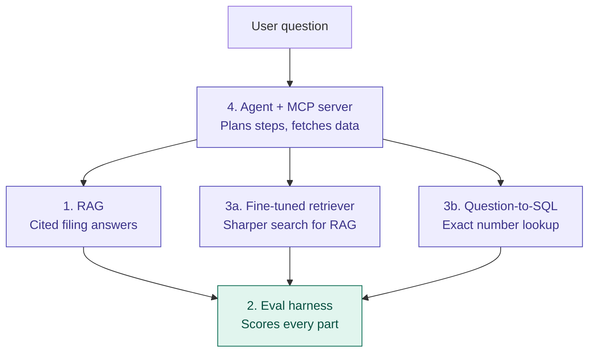

# Earnings Report Analyst

**Problem:** company filings are hundreds of pages long, and LLMs invent numbers when asked about them.

**Product:** ask a question about a company, get an answer with exact numbers and a link to the source page.

## Architecture



Purple = product, teal = measurement.

## Parts

| # | Part | Problem it solves | Proof it works |
|---|------|-------------------|----------------|
| 1 | RAG with citations | LLMs invent facts; answers must be checkable | Answers link to the right page |
| 2 | Eval harness | Without scores, we can't tell if a change helped | One command prints a score table |
| 3a | Fine-tuned retriever | Generic search mixes up finance terms | Retrieval accuracy, before vs after |
| 3b | Question-to-SQL | RAG is unreliable for exact numbers in tables | Query accuracy on test questions |
| 4 | Agent + MCP server | Real questions need several steps and both tools | Multi-step questions answered correctly |
| 5 | Mini transformer (separate repo) | Shows fundamentals, built from scratch | Trains and generates text |

## Build order

- [ ] 1. RAG — everything else plugs into it
- [ ] 2. Eval harness (small version) — scores before improvements
- [ ] 3. Fine-tuned retriever (3a)
- [ ] 4. Numbers database + question-to-SQL (3b)
- [ ] 5. Agent + MCP server
- [ ] 6. Mini transformer — side project, any time

## Project structure

```
earning-analysis/
├── pyproject.toml   ← dependencies, installed with uv
├── requirements.txt ← same dependencies, for pip
├── src/
│   └── rag/         ← part 1 code + its README
├── notebooks/       ← Colab notebooks that run src/
└── data/            ← sample filings
```

Each part's folder has its own `README.md` covering the problem, the class structure, and what each component does. Folders for the other parts are added as we build them.

## Setup

With uv:

```
uv sync
```

With pip (used on Colab):

```
pip install -r requirements.txt
```

`requirements.txt` is generated from `pyproject.toml`. After changing dependencies, refresh it with:

```
uv export --no-hashes -o requirements.txt
```

## Decisions

- Code runs on Google Colab (free tier)
- Dependencies are managed with uv

## Open decisions

- Which companies and years to cover
- Which models to use
